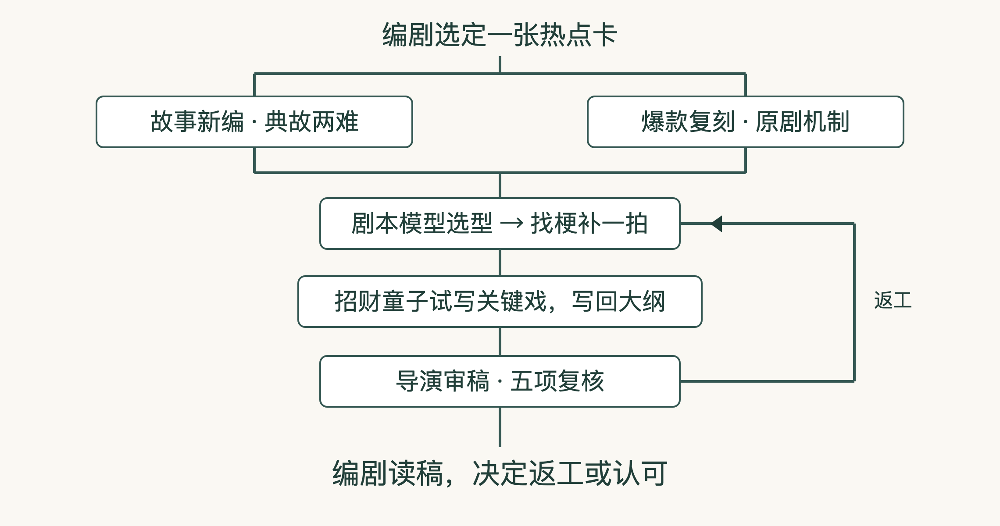

# 《北京一家人》编剧实战路线图

> 手册类型：通用版

## 阅读说明

第一次打开「剧本系统」，可以先试写一个动作。小宁想让爷爷歇一天，给等修车的街坊发了号码牌。第一张牌发出去，谁反而更放心了？写到那个人动手，就有了检验工具的第一份稿。

本册用教学试写演示怎样提要求、读答卷、接下一句。文中标作“首轮记录”的材料来自仓内已有模型答卷。编剧可以另选高潮与结尾。所有输入框里的文件路径都从下载的仓库根目录算起。

本工作包有 **177 个 Skill、5 个编剧岗位、1 套招财童子自动化**，自动化另附一个内部大纲 Skill。动画片单有 300 个编号条目，89 项附本地资料，另有 40 项喜剧细查；国际动画研究含 10 个系列、16 个故事。曹小卉和宫崎骏两位导演对应三个视角技能。三部家庭喜剧共 526 个本地集标、1,110 张梗卡，可按动作检索。52 个动画人物、14 个西游人物和 26 个短剧桥段技能均已计入技能总数。[按创作问题查用法](https://ziyetsui.github.io/script-system/)

## 从 setup 到交稿的路线图

| 手上有什么 | 从哪里开始 | 本轮带走什么 |
| --- | --- | --- |
| 想让 Codex 下载工作包 | [一句话安装](#section-setup) | 读到「写大纲」技能 |
| 不知道用什么技能 | [三句芝麻开门](#section-beginner) | 一句能带自己稿子试的问法 |
| 想看热点怎样长成一集 | [《纸窗内外》四轮实例](#section-example) | 从选线头到修动机的一次完整练习 |
| 刚下载的文件夹 | [打开仓库，试写一个动作](#section-setup) | 一段能接下一场的试写 |
| 一个点子，高潮还没定 | [选高潮由谁行动](#section-choice) | 编剧选定的讲法及代价 |
| 一个已选讲法 | [写成约 500 字大纲](#section-outline) | 有起因、有后果的 V1 |
| 一版旧稿，中段卡住或结尾跑题 | [从最早断开的动作改](#section-edit) | 能与原稿对照的 V2 |
| 两张候选，或一个具体难题 | [只请需要的岗位](#section-roles) | 可交给下一人的候选卡或返工意见 |
| 一张已选、有来源的热点卡 | [让招财童子交推荐稿](#section-automation) | 推荐大纲、取舍和续改记录 |
| 新会话，或准备把稿交给同事 | [接续与定稿](#section-handoff) | 可核对的稿号、保留项和状态 |

第一次练习从步骤 1 开始，之后再看[附录的历史答卷与常见卡点](#section-recipes)。

## 本手册按以下读者画像编写

写家庭轻喜剧或动画单集的编剧，手里只有 GitHub 上下载的「剧本系统」，能使用一款已经登录、可以读本地文件的写作 Agent。练习材料已写在提示词里。

## 条件不同时怎么调

只有网页聊天时，打开指定的 Markdown 文件，把正文及本轮要读的参考文件一并附上。有旧稿就从步骤 4 开始。换成别的剧集时，把康家人物、总纲、不可改的选择换成该剧的设定；招财童子一章用的是《北京一家人》的交稿标准。

<a id="section-setup"></a>

## 步骤 1 打开仓库，试写一个动作

**目标**　让 Agent 读到正确的一份技能正文，并从一个生活点子写出可表演的后果。

在 Codex 里打开准备写稿的文件夹，发这一句：

```text
帮我安装剧本系统（https://github.com/ziyetsui/script-system），在当前项目下载或复用工作包，读里面的「skills/故事开发/SKILL.md」告诉我怎么开始写大纲。
```

1. 喜欢自己下载时，在 GitHub 仓库首页选 **Code → Download ZIP** 并解压。会用 Git 的读者也可在 **Code → HTTPS** 复制地址，运行 `git clone 仓库地址 剧本系统`，把“仓库地址”换成刚复制的值。
2. 找到同时有 `skills/`、`agents/`、`automations/` 的那层。ZIP 解压后的名字可以带分支名。在 Cursor 用 **Open Folder** 打开这一层并进入 Agent 聊天；用 Claude Code 或 Codex CLI 时，在这一层打开终端，运行已安装的 `claude` 或 `codex`。Codex 桌面端可直接把这一层选为项目。
3. 看到读出的技能名“写大纲”，就贴下面的修车练习，看看街坊的反应怎样改变小宁的处境。<a id="cite-o1-1"></a>[O1](#source-o1)

```text
/写大纲 小宁想让爷爷歇一天，给等修车的街坊发号请他们先散，请写发出第一张牌后的三个动作，停在小宁得亲自处理的新麻烦上。
```

**做完的标准**　从街坊的反应里，找出改变现场的那个动作。教学示例：“邻居把一号牌收进兜，咔哒一声把车锁在院门边，把钥匙递给小宁。原本想推车回家的人，也来问还有没有二号。”此时小宁成了替大家收车的人。


<a id="section-beginner"></a>

## 新手入门 · 最好用的三句芝麻开门

**记一种写法就够了：`/技能名称 + 想让它帮忙的那件事`。** 比如 `/写大纲 小宁想让爷爷歇一天，却替他接了六辆车的活，请给我两个不同的高潮让我选。` 所有技能都可以按仓库首页的中文名或英文名点名。斜杠菜单取决于当前工具注册了哪些命令；如果菜单里找不到，就在普通对话里说“用剧本系统里的『写大纲』帮我……”，Codex 可以按 README 找到对应的技能文件。

> **Tips｜为什么大多数 Skill 用英文命名？** 建库时优先沿用英文编剧术语，让 Codex 能按原名找到对应的写作方法。比如看到 `story-circle`，可以直接用中文说：“用哈蒙故事圈帮我看看，小宁为了查清这张照片付出了什么代价？”仓库首页把中英文名称并排列出，写需求、贴原稿和提修改意见都可以用中文。

### ① `/热点` 找选题

```text
/热点 我想给《北京一家人》写一集关于科学探索精神的故事，请找三条有原文可查的北京生活新闻，每条附出处和一件小宁可能想亲手验证的事。
```

挑一条你想往下写的新闻，把报道原文和为小宁设想的动作分开留好。[热点选题](../../skills/hotspot/SKILL.md)

### ② `/群策` 从选中的新闻挖故事

```text
/群策 我选平谷小学地质科普课这条新闻，请让导演审稿、剧本模型和找梗各试一条故事线，写清小宁先信了什么、哪件事让他改主意、最后得舍掉什么，等我选。
```

把例句里的新闻换成你选的那条。群策会先查技能库，挑出这次用得上的方法；支持多个 Agent 时，各组可以同时试写。读完候选，选你最想看下去的那场戏。[群策分派规则](../../skills/swarm/SKILL.md)

### ③ `用剧本系统skill` 把选中的一场改顺

```text
用剧本系统skill 帮我改小宁拿到旧车票就去查救援这段，挑一个适合写探案线索的技能，让他先认出照片里自家的黄被子，再有理由去问爷爷。
```

有想用的方法可以点名，比如借柯南式线索、哆啦A梦的道具或《老友记》的群像误会；拿不准时，贴上原段，说清哪一拍让你没看懂就行。[柯南式线索设计](../../skills/conan-skill/SKILL.md) · [哆啦A梦角色卡](../../skills/animation-character-skills/doraemon-skill/SKILL.md)

<a id="section-example"></a>

## 实例 · 四轮写出《纸窗内外》

一堂讲山体滑坡的小学科普课，怎么会写成一个孩子追问“陌生男孩为什么盖着我的被子”的故事？下面把这集的 38 条创作提示整理成四轮。按顺序把这四句发给同一个 Codex 对话即可。提示词为教学改写，三个候选和结尾都可回查。[38 条原始提示词回顾](../example/《纸窗内外》-38条提示词回顾.md) · [完整大纲](../example/《纸窗内外》-最终大纲.md)

### 1. 热点：先找能让孩子动手的一件事

```text
/热点 这集想写科学探索精神，请从平谷靠山集中心小学地质科普课的报道里找一件孩子能亲手验证的事，分开写课堂事实和康小宁回家后的设想。
```

**这轮拿到的线头**：课堂上，讲师用野外影像和模型讲地质现象。到了康家，小宁看到院墙上的斜缝，想在学校科普展上用模型还原它。编剧现在可以抓住一个问题往下写：**照片和模型看起来一样，就能说明墙是这样裂的吗？** 原会话里，这堂课是热点列表的第 10 条。[当时选用的报道](https://www.geosociety.org.cn/?v1=v14&v2=6abe2d0113f7d&v3=v41&v4=v17&v6=1)

### 2. 群策：同一条新闻里，有哪些故事可挖？

```text
/群策 请从这堂地质科普课挖出三个能独立成集的故事，各写小宁原本相信什么、看见什么才起疑、最后得舍掉什么，等我选。
```

| 群策给出的候选 | 编剧可以挑哪场戏 |
| --- | --- |
| 《跟着山跑的尺子》 | 牙签尺和坡面一起移动，小宁误以为山没动。要重新测，就得亲手浇坏他做了两晚的纸灯笼铺。 |
| 《照片里那道缝》 | 同一摞照片，一家人排出了三种先后顺序。小宁发现拍摄角度就能让裂缝显得更宽，得撤回已经装裱好的展板。 |
| 《纸窗外面》 | 透过纸板方孔，画上去的线和两块板之间的缝一模一样。小宁把印好的主持卡扣下，把科普展第一个上台的位置让给下一组。 |

系统首推第一条，编剧选了**第三条**。吸引编剧的是照片被裁掉的另一半：小宁原本只想看清墙，那一半里还可能有谁？

### 3. 深挖：告诉系统“我的直觉是……”

```text
/柯南式线索设计 我选《纸窗外面》，直觉是照片外藏着一件感人的事，请沿照片边缘挖两条探案线，其中一条接上 K396 救援，标出小宁看见的虚构线索和能核对的事实。
```

**这集沿着被角往下写了**：整张照片里，墙根坐着一个陌生男孩。小宁认出男孩身上那床黄被子，被角的小船是他小时候央爷爷绣的。他有理由去问爷爷：“他怎么盖着我的被子？”接下来翻出旧车票、查车次，就都有了来由。男孩、黄被子和康家旧照是本集的虚构线索。

### 4. 改稿：指出“哪一拍不对”，再看替换后的戏

```text
/写大纲 小宁拿票就搜救援像是提前知道了答案，请只重写从收模型到查车次这一段，让他先认出男孩身上的黄被子，再想查他去了哪里，把照片背面的“小康家”留到最后。
```

**可以这样改（按成稿压缩）**：小宁回家把模型往抽屉里塞，底座顶住一本旧相册。他把相册抽出来，一张照片滑到桌上。还是那道墙缝，可照片边上坐着个男孩，身上那床黄被子露出半只绣歪的小船。小宁把照片举到爷爷眼前：“他怎么盖着我的被子？”爷爷认出照片，让他摸摸封底的纸袋。小宁抽出一张终点北京丰台的旧票。他想知道男孩后来去了哪儿，这才把车次和日期输进去，却读到列车当年停在了落坡岭。

这次改动给了小宁一个**查车次之前就已经在乎的问题**。它也能撑到结尾：科普展上，童子又问“那他最后，到哪儿了？”，小宁把照片翻过来：“你自己看。”背面只有三个字——**小康家**。

<a id="section-choice"></a>

## 步骤 2 选高潮由谁行动

**目标**　把一个点子变成编剧能点选的两个故事方向。<a id="cite-o2-1"></a>[O2](#source-o2)

1. 说清谁想做什么、谁有另一个打算、哪件事必须保住。主角还没定时，直接把这项决定交给首轮比较。
2. 要求从不同经典故事或戏剧结构中找候选，逐案写出高潮动作及代价。收到候选后，遮住类型名，再读最后一拍。
3. 用一句话选案，连同最想保留的那一拍交给步骤 3。两个结尾若都是小宁说“我懂了”，请重写其中一个结尾，直到能演出不同的结果。

```text
/单集故事选型 奶奶约好去选谱，小宁却替她排了节目，请跨经典戏剧结构给两个能让奶奶赴约的高潮，写清谁行动、谁舍掉什么，等我选。
```

**做完的标准**　可用动作选案。教学示例中，一版是小宁亲手拉开门帘，舍掉今晚最想给奶奶看的最后一个机关；另一版是奶奶拒绝全家替她改约，自己定下另一次看戏的时间。两版会让观众在高潮跟随不同的人。


<a id="section-outline"></a>

## 步骤 3 把选定讲法写成约 500 字大纲

**目标**　交一份从孩子的愿望一直写到孩子亲自面对后果的 V1。

1. 贴回选定的高潮、主题和不可改的事实。沿用同一会话时，指明选的是哪一个动作。
2. 让 Agent 把起承转合写成连贯故事。中段至少找出一次原本合理的补救，写出别人为什么会把局面推向意外处。
3. 从结尾向前倒读一遍。若删掉一场，下一场照样成立，圈出这两场之间缺的行动，只退回这一段。

```text
/写大纲 请把选定的门帘版写成约 500 字的 V1，从小宁缩短节目写到他舍不得删掉苦练的动作，最后由他拉开门帘让奶奶赴约。
```

**做完的标准**　读者能说出小宁为何想留人、第一招为何值得试、哪次回应使旧办法失效，以及他最后舍掉了什么。


<a id="section-edit"></a>

## 步骤 4 从最早断开的动作改

**目标**　搞清楚一场戏为什么接不下去，区分要补桥段还是要改主题走向。

1. 贴原段，标明稿号、前场、后场。只缺接招时用 `agents/找梗.md`；结尾的转念没有依据时用 `skills/liang-zuo-perspective/SKILL.md`。<a id="cite-o3-1"></a>[O3](#source-o3)
2. 先圈原稿中值得保住的一笔。修车例里，发号码是小宁真心给爷爷解围。保住这份好意，才能让后面的误会既好笑又让人心疼。
3. 把需要核对的原剧动作与本集的原创动作分开。收到修改稿后检查主题：奶奶如期出门，小宁还能舍不得。若奶奶因为孩子苦练而留下登台，退回改变她行程的那一拍。

```text
/梁左 请改这段“小宁搬凳子挡门，奶奶见他满头汗就留下看戏”，保住小宁盼她看戏的委屈，写出他亲手让路、奶奶照常赴约的替换段。
```

**做完的标准**　把“我懂了”删掉，观众仍看得出小宁把哪一个决定还给了奶奶。


<a id="section-roles"></a>

## 步骤 5 只请需要的岗位

**目标**　给一个明确的卡点找到接手的人，拿到能交给下一位的东西。<a id="cite-o4-1"></a>[O4](#source-o4)

1. 从下表选一个岗位，把上一场或候选卡全文、待决定的问题和必留项一起交过去。
2. 要求用候选编号交回结果。原作依据能查到时给位置，依据不足时保留缺口。单会话能逐个读岗位文件；支持子 Agent 的宿主也可分别派给两路取材岗位。
3. 交给下一人前，写清哪项已经点选、哪项还可推翻。结构已定，只差一个接招时，直接走找梗这一步。

| 岗位正文 | 交给它的问题 | 拿什么继续 |
| --- | --- | --- |
| `agents/故事新编.md` | 一个典故里的承诺，放到康家谁先付代价？ | 典故出处、原人物的两难、今天的新事件 |
| `agents/爆款复刻.md` | 哪一处原剧场面能说明为什么会露馅？ | 集或场的位置、原动作、康家原创用法 |
| `agents/剧本模型.md` | 两张候选里，哪个高潮由孩子承担？ | 不同主角、升级方式、代价及各自的卡点 |
| `agents/找梗.md` | 发了号码，怎么会招来更多车？ | 动作、对方回应、下一步选择 |
| `agents/导演审稿.md` | 这版最先该返工哪一处？ | 稿内证据、退回岗位、复核办法 |

```text
找梗岗位，请用院门、车铃或一把锁给我两个接法，让小宁发修车号码之后不得不亲自撤单，各标出借用的机制和出处。
```

**做完的标准**　交接时能说“采用 A 案的锁车交钥匙，撤单仍由小宁承担”。若岗位答复只有一个有趣的段子，再追问“段子说完，谁现在非做一件事不可？”

<a id="section-automation"></a>

## 步骤 6 让招财童子交推荐稿

**目标**　把一条有出处的热点转成康家的一件小事，读到经过关键戏试写和审稿的推荐大纲。<a id="cite-o5-1"></a>[O5](#source-o5)

1. 贴一张真实材料卡，含标题、事件、出处和最想保住的人物选择。把报道事实与打算为本集虚构的事分行写。仅有“选第 3 条”时，需同时有上一轮的完整列表。
2. 从包内项目总纲找价值原词与位置，解释这个切口怎样改变孩子的选择。两路取材后，招财童子汇合候选、试写最难的一场，再把试出来的动作写回大纲。
3. 对照五项审读意见。**故事性**看发号如何造成额外承诺；**核心价值**看撤单由谁承担；**北京特色**看当地公共生活哪条具体规则改变安排；**温暖的轻喜剧**看街坊为什么乐于按新办法办事；**逻辑自洽**看每把钥匙从谁手里到了谁手里。
4. 检查交件。片名与约 500 字推荐稿在前，另一条路线的取舍与续改记录在后。若抽掉热点，孩子面对的选择仍完全相同，把切口退回两路取材；结构松散退给剧本模型；包袱没有后果退给找梗。



教学示意，依据包内单集开发步骤绘制于 2026-11-26。两路取材共享同一张卡，合稿后由导演审读，编剧决定是否认可。

**贴在一张真实热点卡之后使用**

```text
招财童子，请按 automations/招财童子/FOR_AGENTS.md 从上面的热点卡走完两路取材、关键戏试写和五项审稿，交约 500 字推荐稿、另一案的取舍和待反馈稿号。
```

**做完的标准**　能指出报道中的哪件事造成了孩子的两难、关键戏试出了什么、哪一个问题仍值得编剧裁决。需严格按原项目路线图逐项对照时，另附该原文。

<a id="section-handoff"></a>

## 步骤 7 接续与定稿

**目标**　离开会话后，同事仍能从同一个稿号接着改。

1. 保存推荐稿全文，写下稿号、选材出处、已选的动作、编剧原话和仍待决定的一处。跨会话时粘贴这份记录和稿件。
2. 每轮只指认本次要改的位置，说明哪些人物决定要保住。让 Agent 写回新稿号与改动；把相邻两场连读，核对改动影响。
3. 编剧读过后明确给出状态。“选门口版”只决定分支；“V3 这版大纲通过”才对应整稿认可。需要分场时，带上这份认可稿，逐场列地点、愿望、阻碍、动作及改变的局面。

```text
请接续所附《奶奶的约会》V2，只改小宁第二次挽留，保住他的委屈和奶奶赴约，交 V3、改动对照和一处待我决定的问题。
```

**做完的标准**　新接手的人能找到同一份全文，说出能改哪里，以及哪位编剧明确认可了哪个版本；暂无认可时就保留待反馈。

<a id="section-recipes"></a>

## 附录 · 首轮答卷与常见卡点

**按现场问题找例子。** 以下是已有模型试跑的结果摘意。目录位置从仓库根开始。<a id="cite-o6-1"></a>[O6](#source-o6)

| 起点 | 这轮做了什么 | 答卷里留下的动作 | 回查编号 |
| --- | --- | --- | --- |
| 纸偶戏该跟爸爸还是小宁 | 比两个高潮 | 爸爸退演示费；另一案让小宁把答话的纸偶递回爸爸 | group-01 / run-002 |
| 小宁想让爷爷歇一天 | 给修车的人发号码 | 街坊反而放心锁车，把钥匙交给小宁 | group-01 / run-008 |
| 奶奶要去选谱 | 改门口的选择 | 小宁追问几点看，奶奶自己定明早 | group-03 / run-044 |
| 想借家庭喜剧里的求情 | 找具体集与动作再改编 | 妹妹抢先替哥哥答应当晚放录音 | group-02 / run-021 |
| 要把尊敬演成台上动作 | 给双方一个能看见的暗号 | 老人敲铁盒，台上的人等半拍 | group-06 / run-082 |
| 想试人物如何护住一船人 | 在船戏里安排一个延后揭开的事实 | 同伴从账本看见提前画好的避风路线 | group-08 / run-153 |

**找不到 `/写大纲`。** 在普通对话中请 Agent 直接读取 `skills/故事开发/SKILL.md`，再贴步骤 1 的修车练习。技能声明名叫“写大纲”，文件夹叫“故事开发”。宿主的命令菜单取决于本机注册。

**提示“找不到文件”。** 回到能同时看见 `agents/` 和 `skills/` 的一层。遇到旧示例的 `sstack/skills/…`，在独立仓库从 `skills/…` 开始。材料如写在父项目的 `docs/materials/`，先用手头可核的原文；仍缺证据就请 Agent 标出缺口。包内总纲在 `docs/harness/`。

**答复像开会，没有戏。** 直接追问：“只交下一场开头三行。第一行动完，第二个人手里多了什么、少了什么，或者答应了什么？”

**要查《我爱我家》的原剧依据。** 从仓库根运行下面的只读查询，查看第 65 集指定时刻附近的本地转写。引用时对照上下文，听辨有疑问的原话保留待核。

```sh
python3 skills/liang-zuo-perspective/scripts/find_scene.py --episode 65 --at 00:04:40
```

**一张可复制的续改卡。** 方括号内填写本集实际信息。

```text
请接续[片名／稿号]，依据[出处及已核事实]和[本集原创设定]保留[编剧已选动作及原话]，只改[场次与问题]，按[交件形式]交回并标[状态]，当前稿见下文。
```

## 来源与适用范围

<a id="source-o1"></a> **O1**　技能声明与开发范围见 `skills/故事开发/SKILL.md`。[回到正文](#cite-o1-1)

<a id="source-o2"></a> **O2**　跨体系选型、点选后再扩写见 `skills/aiscript-story-type/SKILL.md`。[回到正文](#cite-o2-1)

<a id="source-o3"></a> **O3**　按最早坏掉的行动修稿，见 `skills/liang-zuo-perspective/SKILL.md` 及其 `references/casebook.md`。[回到正文](#cite-o3-1)

<a id="source-o4"></a> **O4**　五个岗位的输入与交接见仓库根 `agents/` 下五份岗位正文。[回到正文](#cite-o4-1)

<a id="source-o5"></a> **O5**　两路取材、关键戏试写、五项审稿、续改和认可状态见 `automations/招财童子/FOR_AGENTS.md` 与同目录下的 `skills/develop-outline/SKILL.md`。[回到正文](#cite-o5-1)

<a id="source-o6"></a> **O6**　答卷索引在 `skills/试跑记录/2026-11-26/README.md`。原轮覆盖 173 项，167 项交齐、5 项有缺口、1 项受阻。这里引用其中六份；上表标出分组及答卷编号。[回到正文](#cite-o6-1)
