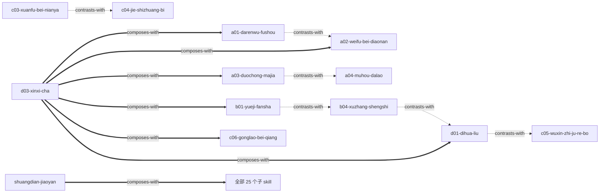

# 《400 个爆款短剧剧本爽点》 — Skill Index

> 本书由 cangjie-skill 蒸馏，共产出 **26** 个 skills（25 个爽点套路 + 1 个元校验技能）。
> 处理时间: 2026-08-21

## 关于这本书

- **作者**: 佚名（网文/短剧爽感套路汇编）
- **一句话主旨**: 短剧/网文的爽感来自"对比、反差、信息差"三种底层机制，可拆为身份反差、实力碾压、打脸反转三大类共 25 个可直接复用的桥段套路。
- **整书理解**: 见 [BOOK_OVERVIEW.md](./BOOK_OVERVIEW.md)
- **精华长文** (不读全书看这篇): [DIGEST.md](./DIGEST.md)
- **术语词典**: [GLOSSARY.md](./GLOSSARY.md)

---

## Skill 列表 (按主题分组)

### A 类 — 身份反差・隐藏大佬（扮猪吃虎核心体系，8 个）

- [`a01-darenwu-fushou`](./a-shenfen-fancha/a01-darenwu-fushou/SKILL.md) — 大人物俯首：权威者当众反常恭敬，认证主角隐藏地位
- [`a02-weifu-bei-diaonan`](./a-shenfen-fancha/a02-weifu-bei-diaonan/SKILL.md) — 微服被刁难・有眼不识泰山：前压后弹式当众打脸
- [`a03-duochong-majia`](./a-shenfen-fancha/a03-duochong-majia/SKILL.md) — 多重马甲：一个主角，N 个赫赫有名的传说
- [`a04-muhou-dalao`](./a-shenfen-fancha/a04-muhou-dalao/SKILL.md) — 幕后大佬：培养门生，世人嘲笑，徒弟认主引爆反差
- [`a05-qinyou-buzhiqing`](./a-shenfen-fancha/a05-qinyou-buzhiqing/SKILL.md) — 亲友不知情：全世界知道主角厉害，唯独家里不知道
- [`a06-saodiseng-shijue`](./a-shenfen-fancha/a06-saodiseng-shijue/SKILL.md) — 扫地僧式角色：不起眼职业 + 顶级实力 = 深藏不露
- [`a07-wujian-waimao-fancha`](./a-shenfen-fancha/a07-wujian-waimao-fancha/SKILL.md) — 物件与外貌反差：破旧物品是珍宝，其貌不扬实为惊艳
- [`a08-shien-yu-guiren`](./a-shenfen-fancha/a08-shien-yu-guiren/SKILL.md) — 施恩遇贵人：随手善行，意外靠山

### B 类 — 实力碾压・越级反杀（7 个）

- [`b01-yueji-fansha`](./b-shili-nianya/b01-yueji-fansha/SKILL.md) — 越级反杀・绝境翻盘：超出预期的赢法（含死后复活变体）
- [`b02-po-bingqi-sheng-shenbing`](./b-shili-nianya/b02-po-bingqi-sheng-shenbing/SKILL.md) — 破兵胜神兵：装备预期差的碾压
- [`b03-dazhao-wu-lengque`](./b-shili-nianya/b03-dazhao-wu-lengque/SKILL.md) — 大招无冷却：反常规机制碾碎反派预判
- [`b04-xuzhang-shengshi`](./b-shili-nianya/b04-xuzhang-shengshi/SKILL.md) — 虚张声势：不战而屈人之兵
- [`b05-jinzhishou-ziyuan`](./b-shili-nianya/b05-jinzhishou-ziyuan/SKILL.md) — 金手指与资源碾压：起点即终点（含弱点修复）
- [`b06-peijue-hongtuo`](./b-shili-nianya/b06-peijue-hongtuo/SKILL.md) — 配角烘托：主角越不出手，显得越强
- [`b07-juzhong-ruoqing`](./b-shili-nianya/b07-juzhong-ruoqing/SKILL.md) — 举重若轻：别人历尽千辛，主角轻松搞定（含善待手下）

### C 类 — 打脸反转・当众处刑（6 个）

- [`c01-jiazufan-dalian`](./c-dalian-fanzhuan/c01-jiazufan-dalian/SKILL.md) — 家族嘲讽反打脸：亲缘背叛的加倍反转
- [`c02-xiaozhang-zhuan-xianmei`](./c-dalian-fanzhuan/c02-xiaozhang-zhuan-xianmei/SKILL.md) — 嚣张转谄媚：同一张脸的两个极端
- [`c03-xuanfu-bei-nianya`](./c-dalian-fanzhuan/c03-xuanfu-bei-nianya/SKILL.md) — 炫富炫技被碾压：炫耀变成献丑
- [`c04-jie-shizhuang-bi`](./c-dalian-fanzhuan/c04-jie-shizhuang-bi/SKILL.md) — 借势装 X 自取其辱：虚假资本的崩塌
- [`c05-wuxin-zhi-ju-re-bo`](./c-dalian-fanzhuan/c05-wuxin-zhi-ju-re-bo/SKILL.md) — 无心之举引风波：误读驱动的冲突引擎
- [`c06-gonglao-bei-qiang`](./c-dalian-fanzhuan/c06-gonglao-bei-qiang/SKILL.md) — 功劳被抢真相大白：迟到的正义更解气

### D 类 — 特殊叙事手法（4 个）

- [`d01-dihua-liu`](./d-xushi-shoufa/d01-dihua-liu/SKILL.md) — 迪化流：主角越无辜，配角越敬畏（脑补机制）
- [`d02-puguang-liu`](./d-xushi-shoufa/d02-puguang-liu/SKILL.md) — 曝光流：低姿态 + 大结果的无声碾压
- [`d03-xinxi-cha`](./d-xushi-shoufa/d03-xinxi-cha/SKILL.md) — 信息差：反转的底层引擎（三大底层逻辑之一，可独立复用）
- [`d04-xitong-weizhuang`](./d-xushi-shoufa/d04-xitong-weizhuang/SKILL.md) — 系统加持伪装实力：假面板，真底牌

### 元技能（1 个）

- [`shuangdian-jiaoyan`](./meta-shuangdian-jiaoyan/SKILL.md) — 剧本爽点缺失校验：用全目录体检剧本的爽点分布/密度/多样性/雷区

---

## 引用图



图例:
- `-->`  depends-on
- `-.->` contrasts-with
- `===>` composes-with

> 完整依赖/对比/组合关系见各 SKILL.md 末尾的"相关 skills"段。核心结构：**信息差（d03）是所有反转类 skill 的依赖基座**；**爽点校验（meta）组合全部子 skill**。

---

## 推荐学习顺序

1. **d03-xinxi-cha（信息差）** — 最底层引擎，无前置，几乎所有桥段的根基。
2. **a01/a02（身份反差入门）** — 依赖信息差，最易上手的扮猪吃虎套路。
3. **b01/b07（实力碾压入门）** — 战斗与效率爽点的两个方向。
4. **c01/c02（打脸入门）** — 依赖信息差 + 身份铺垫，注意反降智。
5. **d01/d02/d04（手法层）** — 可叠加在任何桥段上的叙事手法。
6. **shuangdian-jiaoyan（元技能）** — 掌握全部套路后用于剧本体检。

---

## 安装使用

本目录是构建产物，宿主不会从这里加载 skill。要让 agent 真正调用，把 skill 目录复制到宿主的 skills 目录:

```bash
# 用户级 (所有项目可用)
cp -r a-shenfen-fancha/* ~/.dsh/skills/          # DeepSeek Harness（或逐 skill 复制）
cp -r b-shili-nianya/* ~/.agents/skills/         # 跨 Agent 共享
cp -r c-dalian-fanzhuan/* ~/.claude/skills/      # Claude Code

# 或项目级
cp -r <skill-dir> <project>/.dsh/skills/         # DeepSeek Harness
cp -r <skill-dir> <project>/.agents/skills/      # 跨 Agent 共享
cp -r <skill-dir> <project>/.claude/skills/      # Claude Code
cp -r <skill-dir> <project>/.cursor/skills/      # Cursor
```

> 建议整包安装：`a-shenfen-fancha/`、`b-shili-nianya/`、`c-dalian-fanzhuan/`、`d-xushi-shoufa/`、`meta-shuangdian-jiaoyan/` 五个目录下的所有 skill 一并复制，配合 INDEX.md 使用效果最佳。

---

## 接入 darwin-skill

所有 skill 均带有 `test-prompts.json` (darwin-skill 兼容格式)，可直接接入自动进化:

```
darwin evolve books/400-duanju-shuangdian/
```

---

## 审计轨迹

- 候选单元池: [candidates/](./candidates/)
- 被淘汰的候选 (含原因): [rejected/](./rejected/)
- BOOK_OVERVIEW: [BOOK_OVERVIEW.md](./BOOK_OVERVIEW.md)
- 流水线状态: [PIPELINE_STATE.md](./PIPELINE_STATE.md)
